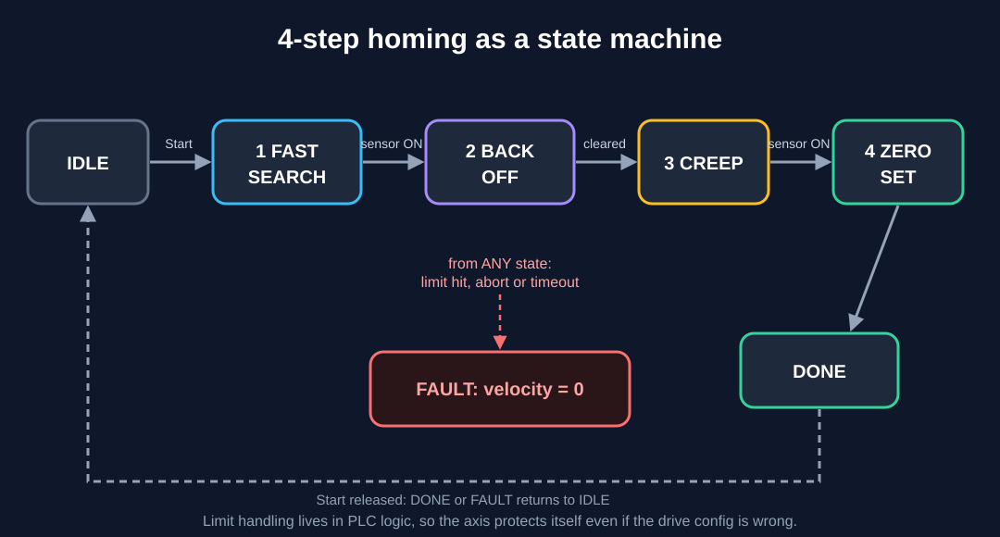
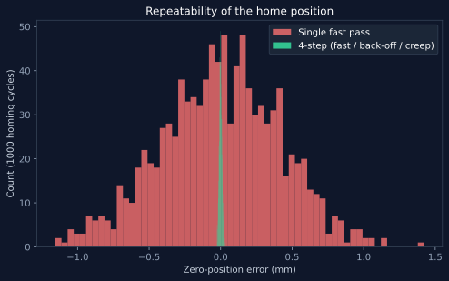

# 01 - Servo homing: why 4 steps, not 1

On a linear axis, "home the axis" sounds like one instruction: drive to the home sensor and call that zero. In practice a single fast approach gives a zero point that **wanders by fractions of a millimetre** from run to run. For a precision operation, that is a rejected part.

## Why one fast pass drifts

The position where the axis stops is not the position where the sensor tripped. It is the trip point plus two things that vary:

1. **Reaction delay jitter.** Sensor filtering and PLC scan time delay the reaction by a few milliseconds, and that delay varies. Distance error = speed x delay, so a faster approach means a bigger error.
2. **Stopping distance variation.** Distance to stop = v^2 / (2a). Friction and load change `a` slightly each run, and the speed is squared.

Both terms shrink sharply as speed drops. That is the whole trick.

## The sequence



1. **Fast search.** Move quickly toward the sensor to save cycle time.
2. **Back off.** Retreat until the sensor clears plus a set distance, so the final approach starts from a known side.
3. **Slow creep.** Re-approach at crawl speed. The trip point is now repeatable.
4. **Zero set.** Latch the position as the new origin.

Implementation: [`homing.st`](homing.st), a vendor-neutral state machine in IEC 61131-3 Structured Text. It was written without a specific toolchain, so syntax-check it in your IDE and map the I/O to your own motion instructions.

## See it: `simulate.py`

```bash
python simulate.py        # standard library only
python plot.py            # optional: regenerates repeatability.svg (needs matplotlib)
```

Result from 1000 simulated cycles per method, using the default illustrative model (200 mm/s fast, 5 mm/s creep):

| Method | Zero std dev | Total spread | Homing time |
|---|---|---|---|
| Single fast pass | 0.417 mm | 2.58 mm | 1.5 s |
| 4-step | 0.0099 mm | 0.059 mm | 3.6 s |

About **42x more repeatable** for about **2 extra seconds** at startup.



These numbers come from a model, not from a real axis. Edit the constants at the top of `simulate.py` to match your own axis.

## Design notes

- **Always approach the final edge from the same side.** Sensor hysteresis differs by direction, so the creep must always come from one direction.
- **Creep speed vs scan time.** Distance travelled per scan = speed x scan time. At 5 mm/s and a 10 ms scan, that is 0.05 mm, which sets a floor on repeatability. Slower creep or a faster scan improves it.
- **Handle limits in logic.** Any limit hit in the direction of travel, abort, or timeout drops to FAULT with zero velocity, so the axis protects itself even if the drive configuration is wrong.
- **Alternative: encoder Z-pulse referencing.** It gives excellent repeatability without a slow creep, at the cost of extra wiring and a sensor that must be placed within one encoder revolution. Sensor + creep is the simpler retrofit.
